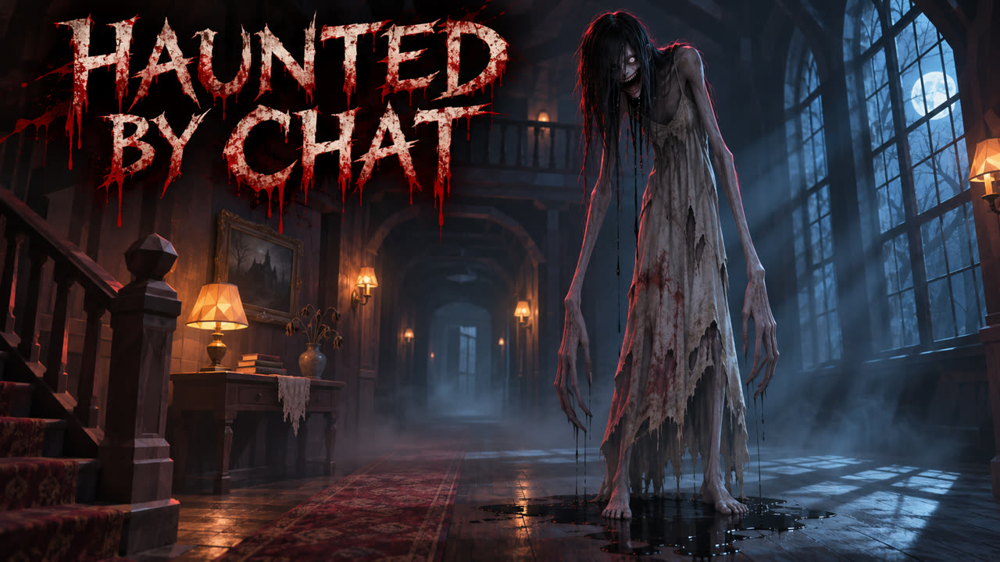

# Haunted by Chat 👁️



A replayable first-person browser horror game spanning a haunted house, moonlit graveyard courtyard, underground crypt, and fractured mirror realm. The house now includes a study, pantry, nursery, guest bathroom, and a cellar washroom. Follow a randomized trail of five keys while Mother hunts you. A revolver can stagger her, and enough hits drive her off — she always comes back angrier.

The game is single-player by default. Twitch chat controls are available only when you explicitly choose **Streamer mode**.

## Run locally

```bash
npm install
npm run dev
```

Open `http://localhost:5173/` and choose **Play**.

For Streamer mode, add a Twitch channel to the URL and choose **Streamer mode** on the title screen:

```text
http://localhost:5173/?channel=yourname
```

The Twitch connection is anonymous and read-only. It does not use OAuth or require a sign-in.

## Goal and controls

- Find five keys, then return to the front door and press `E` to escape.
- Keys progressively unseal the courtyard, crypt, and mirror realm. Each key has its own shape and color. The NEXT display names the room that hides the current key, and a quiet chime plays when you enter that room.
- Use `WASD` to move and the mouse to look.
- Hold `Shift` to sprint while stamina lasts.
- Left-click to fire the revolver. `R` reloads. A run starts with five rounds in a six-round cylinder. Boxes of ammunition are scattered through the house and the other realms.
- A hit staggers Mother and she investigates the shot. Six hits drive her off for a while. She returns with more health and a faster hunt. Further banishments make her angrier still.
- Press `E` near a hiding spot to hide or leave. New spots include the study desk, the pantry, the crib, the guest-bath curtain, and the cellar tub. Mother searches her last sighting, then patrols away while you remain concealed. A gunshot in a hiding spot can still give you away if she is close.
- Climb the staircase inside the living room to explore the upstairs Widow's Room. The study opens off the living room, the pantry off the kitchen, the nursery off the child's room, the guest bathroom off the main bath, and the cellar washroom off the basement.
- Press `Esc` to release the pointer and pause the timer.

On a phone, rotate to landscape. Drag anywhere in the lower-left movement zone to place the dynamic joystick, swipe the right side to look, and use the on-screen RUN, USE, FIRE, and RELOAD controls.

Each run randomizes key locations, ammo caches, Mother's spawn, and scare timing. Bathrooms can run water or hide a shape behind the curtain. The nursery mobile can spin. Lights in the current room can die. Collecting keys raises the tension: Mother becomes faster and dangerous scares become more frequent. The best escape time is saved in `localStorage`.

## Streamer commands

| Chat message | Effect |
| --- | --- |
| `f` or `!flicker` | Flicker the house lights |
| `w` or `!whisper` | Whisper “behind you” |
| `s` or `!slam` | Slam a nearby door |
| `c` or `!hunt` | Make Mother rush the player |

Autonomous scares remain active in Streamer mode, so the game never depends on chat activity.

## Production build

```bash
npm run build
npm run preview
```

The production files are written to `dist/`. Relative asset paths make the same build suitable for Vercel or a GitHub Pages repository path.

## Built with

Vite, Three.js, and tmi.js.

## Author

Temiloluwa Valentine ([GitHub](https://github.com/Valentinetemi))
